# Հայաստանի ազգային պոլիտեխնիկական համալսարան 
## Դիպլոմային Աշխատանք

---

### Բովանդակություն
* [ԳԼՈՒԽ 1. ԳՐԱՖՆԵՐ: ՀԻՄՆԱԿԱՆ ՍԱՀՄԱՆՈՒՄՆԵՐ և ՊԱՐԶԱԳՈՒՅՆ ՀԱՏԿՈՒԹՅՈՒՆՆԵՐ](#գլուխ-1)
  * § 1.1. Գրաֆի սահմանումը, տեսակները և տրման եղանակները
  * § 1.2. Աստիճաններ, ենթագրաֆներ և ճանապարհներ
* [ԳԼՈՒԽ 2. ՕՊՏԻՄԱԼ ՈՒՂԻՆԵՐԻ ԿԱՌՈՒՑՄԱՆ ԱԼԳՈՐԻԹՄՆԵՐԸ ԿՇՌՎԱԾ ԳՐԱՖՆԵՐՈՒՄ․ ԴԵՅԿՍՏՐԱՅԻ ԵՎ A* ԱԼԳՈՐԻԹՄՆԵՐ](#գլուխ-2)
  * § 2.1. Դեյկստրայի ալգորիթմը. հիմնական գաղափարը և կառուցվածքը
  * § 2.2. Ալգորիթմի աշխատանքի ժամանակը
  * § 2.3. A* ալգորիթմի խնդրի ձևակերպումը գրաֆների տեսության լեզվով
  * § 2.4. Գնահատման ֆունկցիան և դրա բաղադրիչները
  * § 2.5. Հևրիստիկ ֆունկցիա և օպտիմալության պայմաններ
  * § 2.6. A* ալգորիթմի աշխատանքի սկզբունքը և կեղծածածկագիրը
  * § 2.7. A* ալգորիթմի կիրառումը գրաֆում․ պարզ օրինակ
  * § 2.8. A* և Դեյկստրայի ալգորիթմների համեմատությունը
  * § 3.8. Կիրառման սահմանափակումներ և եզրակացություն
* [ԳԼՈՒԽ 3. ԵՐԵՎԱՆԻ ՃԱՆԱՊԱՐՀԱՅԻՆ ՑԱՆՑԻ ԳՐԱՖԱՅԻՆ ՄՈԴԵԼԱՎՈՐՈՒՄԸ ԵՎ ԽՆԴՐԻ ԴՐՎԱԾՔԸ](#գլուխ-3)
  * § 3.1. Ուսումնասիրության առարկան, նպատակը և տարածքային սահմանները
  * § 3.2. Ճանապարհային ցանցի տվյալների հավաքագրումը և գրաֆի կառուցումը
  * § 3.3. Կշռային ֆունկցիաների սահմանումը և հետագա փուլերի խնդիրները
* [Օգտագործված գրականության ցանկ](#գրականություն)

---

<h2 id="գլուխ-1">ԳԼՈՒԽ 1. ԳՐԱՖՆԵՐ: ՀԻՄՆԱԿԱՆ ՍԱՀՄԱՆՈՒՄՆԵՐ և ՊԱՐԶԱԳՈՒՅՆ ՀԱՏԿՈՒԹՅՈՒՆՆԵՐ</h2>

### § 1.1. Գրաֆի սահմանումը, տեսակները և տրման եղանակները

Դիցուք $V = \{v_1, \dots, v_n\}$ -ը ցանկացած ոչ դատարկ վերջավոր բազմություն է, և դիցուք $V^{(2)}$-ը $V$ բազմության տարրերի բոլոր ոչ կարգավոր զույգերի բազմությունն է: Ենթադրենք, որ $E \subseteq V^{(2)}$:

**Սահմանում 1.1.1:** $(V, E)$ կարգավոր զույգին կանվանենք գրաֆ, և այն կնշանակենք $G$-ով:

$G = (V, E)$ գրաֆի $V$ բազմության տարրերին կանվանենք գրաֆի գագաթներ, իսկ $E$ բազմության տարրերին՝ կողեր: Եթե անհրաժեշտ է շեշտել, որ $V$-ն հանդիսանում է $G$ գրաֆի գագաթների բազմություն ($E$-ն հանդիսանում է $G$ գրաֆի կողերի բազմություն), ապա այդ դեպքում մենք կգրենք $V(G)$ ($E(G)$): Եթե $e \in E$ կողը $u, v \in V$ գագաթներից բաղկացած զույգն է, ապա այդ փաստը կգրենք $e = uv$-ով:

Դիցուք $G = (V, E)$ և $G' = (V', E')$ երկու գրաֆներ են:

**Սահմանում 1.1.2:** $G$ և $G'$ գրաֆները կանվանենք հավասար և կգրենք $G = G'$ այն և միայն այն դեպքում, երբ $V = V'$ և $E = E'$:

Ստորև կդիտարկենք գրաֆների տրման մի քանի եղանակներ: Նախ նշենք, որ գրաֆը կարելի է տալ՝ նշելով նրա գագաթների և կողերի բազմությունները: Օրինակ, դիտարկենք $G = (V, E)$ գրաֆը, որտեղ $V = \{v_1, v_2, v_3, v_4, v_5, v_6, v_7\}$ և 
$E = \{v_1v_2, v_1v_6, v_1v_7, v_2v_3, v_2v_7, v_3v_4, v_3v_7, v_4v_5, v_4v_7, v_5v_6, v_5v_7, v_6v_7\}$:

Մեկ այլ եղանակ է գրաֆների տրման երկրաչափական եղանակը, որի էությունը կայանում է հետևյալում. գրաֆի գագաթներին համապատասխանեցնում ենք հարթության կետեր (տարբեր գագաթներին համապատասխանում են տարբեր կետեր), և երկու կետեր միացվում են անընդհատ կորով, որը չի անցնում մեկ այլ գագաթին համապատասխանող կետով՝ այն և միայն այն դեպքում, երբ նրանց համապատասխանող գագաթները կող են կազմում գրաֆում: Օրինակ, վերը նշված գրաֆը կարելի է պատկերել հետևյալ կերպ.

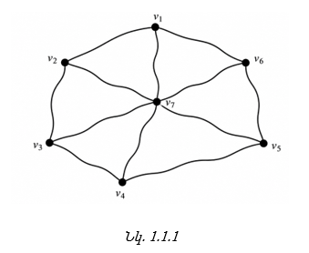
*Նկ. 1.1.1*

**Սահմանում 1.1.3:** $G$ գրաֆը կանվանենք նշված (կամ համարակալված), եթե այդ գրաֆի գագաթներին վերագրված են զույգ առ զույգ տարբեր նիշեր:

Գրաֆներ դիտարկելիս մեզ համար կարևոր է, թե որ գագաթներն են միացված կողով, և որոնք՝ ոչ: Հատուկ նշենք, որ կետերը միացնող կորի ձևը կարևոր չէ: Օրինակ վերը բերված գրաֆը կարելի է պատկերել նաև հետևյալ կերպ.

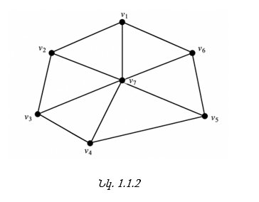
*Նկ. 1.1.2*

Գրաֆների տրման հաջորդ եղանակները նկարագրելու համար տանք մի քանի սահմանում:
Դիցուք $G = (V, E)$-ն գրաֆ է, $u, v \in V$ և $e, e' \in E$:

*   **Սահմանում 1.1.4:** $u$ և $v$ գագաթները կանվանենք հարևան, եթե $uv \in E$:
*   **Սահմանում 1.1.5:** $u$ գագաթին և $e$ կողին կանվանենք կից, եթե $u \in e$:
*   **Սահմանում 1.1.6:** $e$ և $e'$ տարբեր կողերը կանվանենք հարևան, եթե գոյություն ունի $v \in V$ այնպես, որ $v$-ն կից է $e$-ին և $e'$-ին:

Եթե $G = (V, E)$ գրաֆում $V = \{v_1, \dots, v_n\}$ և $E = \{e_1, \dots, e_m\}$, ապա այդ գրաֆին համապատասխանեցնում ենք $n \times n$ կարգի $A(G) = (a_{ij})$ մատրիցը հետևյալ կերպ. $a_{ij} = 1$, եթե $v_i$ և $v_j$ հարևան են, $a_{ij} = 0$ հակառակ դեպքում:
$A(G)$ մատրիցը կանվանենք $G$ գրաֆի հարևանության մատրից: Նկատենք, որ ցանկացած $i$-ի համար ($1 \leq i \leq n$) $a_{ii} = 0$, և ցանկացած $i, j$-ի համար $a_{ij} = a_{ji}$: Նկ. 1.1.1-ում բերված $G$ գրաֆի հարևանության մատրիցը կլինի՝

$$
A(G) = \begin{bmatrix}
0 & 1 & 0 & 0 & 0 & 1 & 1 \\
1 & 0 & 1 & 0 & 0 & 0 & 1 \\
0 & 1 & 0 & 1 & 0 & 0 & 1 \\
0 & 0 & 1 & 0 & 1 & 0 & 1 \\
0 & 0 & 0 & 1 & 0 & 1 & 1 \\
1 & 0 & 0 & 0 & 1 & 0 & 1 \\
1 & 1 & 1 & 1 & 1 & 1 & 0
\end{bmatrix}
$$

Նշենք, որ զրոներից և մեկերից կազմված $n \times n$ կարգի յուրաքանչյուր $A$ մատրից, որը բավարարում է հետևյալ երկու պայմաններին. ցանկացած $i$-ի համար $a_{ii}= 0$, և $a_{ij}= a_{ji}$, հանդիսանում է համարակալված գագաթներով որևէ գրաֆի հարևանության մատրից:

Եթե $G = (V, E)$ գրաֆում $V = \{v_1, \dots, v_n\}$ և $E = \{e_1, \dots, e_m\}$, ապա այդ գրաֆին համապատասխանեցնում ենք $n \times m$ կարգի $B(G) = (b_{ij})$ մատրիցը հետևյալ կերպ։
$B(G)$ մատրիցը կանվանենք $G$ գրաֆի կցության մատրից: Նկատենք, որ կցության մատրիցի սյուները զույգ առ զույգ տարբեր են և յուրաքանչյուր սյուն պարունակում է ճիշտ երկու 1:

$$
B(G) = \begin{bmatrix}
1 & 1 & 1 & 0 & 0 & 0 & 0 & 0 & 0 & 0 & 0 & 0 \\
1 & 0 & 0 & 1 & 1 & 0 & 0 & 0 & 0 & 0 & 0 & 0 \\
0 & 0 & 0 & 1 & 0 & 1 & 1 & 0 & 0 & 0 & 0 & 0 \\
0 & 0 & 0 & 0 & 0 & 1 & 0 & 1 & 1 & 0 & 0 & 0 \\
0 & 0 & 0 & 0 & 0 & 0 & 0 & 1 & 0 & 1 & 1 & 0 \\
0 & 1 & 0 & 0 & 0 & 0 & 0 & 0 & 0 & 1 & 0 & 1 \\
0 & 0 & 1 & 0 & 1 & 0 & 1 & 0 & 1 & 0 & 1 & 1
\end{bmatrix}
$$

Գրաֆների ևս մի ներկայացում, որը մենք կդիտարկենք, դա գրաֆի գագաթների հարևանության ցուցակների միջոցով ներկայացումն է: Եթե $G$ գրաֆում $V(G) = \{v_1, \dots, v_n\}$, ապա դիտարկենք $n$ երկարությամբ զանգված, որի $i$-րդ բաղադրիչն իրենից ներկայացնում է $v_i$ գագաթին հարևան գագաթների ցուցակը՝ գրված ինչ-որ մի կարգով:

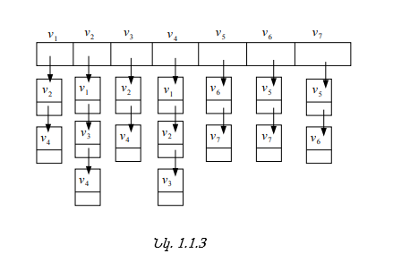
*Նկ. 1.1.3*

Նշենք, որ գրաֆներից բացի, մենք կդիտարկենք գրաֆների մի քանի ընդհանրացումներ: Դրանցից առաջինն են մուլտիգրաֆները: Մուլտիգրաֆի դեպքում $(V,E)$ կարգավոր զույգի մեջ $E$-ն $V^{(2)}$ բազմության մուլտիենթաբազմություն է կամ ցուցակ: Սա նշանակում է, որ $V^{(2)}$ բազմության զույգերը $E$-ում կարող են հանդիպել մեկ անգամից ավելի: Երկրաչափորեն, մուլտիգրաֆները պատկերվում են գրաֆներին համանման եղանակով, միայն թե գագաթներին համապատասխանող հարթության կետերը միացվում են այնքան գծերով, որքան անգամ $E$-ում կրկնվում է համապատասխան զույգը:

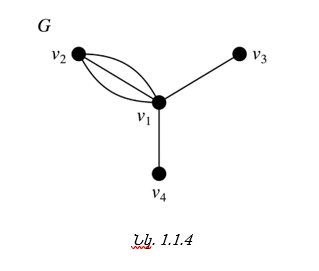
*Նկ. 1.1.4*

Գրաֆների հաջորդ ընդհանրացումն են պսևդոգրաֆները: Պսևդոգրաֆի դեպքում $E$-ն կարող է պարունակել նաև $vv$ տիպի զույգեր, որոնք անվանվում են օղակներ:

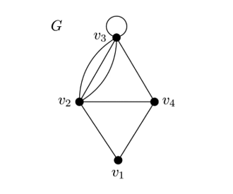
*Նկ. 1.1.5*

Այնուհետև կդիտարկենք կողմնորոշված գրաֆները, որոնք համապատասխանում են այնպիսի $(V, A)$ կարգավոր զույգերին, երբ $A$-ն $V$ բազմության տարրերի կրկնություններով բոլոր կարգավոր զույգերի մուլտիենթաբազմություն է: Երկրաչափորեն այն պատկերվում է սլաքներով:

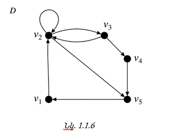
*Նկ. 1.1.6*

Եվ վերջապես, կդիտարկենք հիպերգրաֆներ, որոնք համապատասխանում են այն $(V, E)$ կարգավոր զույգերին, որոնցում $E$-ն $V$-ի ոչ դատարկ ենթաբազմություններից բաղկացած բազմության ենթաբազմություն է:

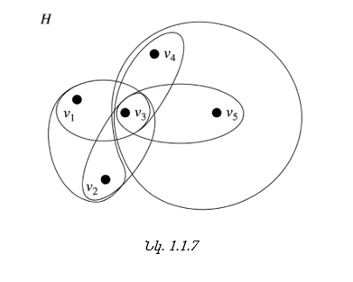
*Նկ. 1.1.7*

### § 1.2. Աստիճաններ, ենթագրաֆներ և ճանապարհներ

Դիտարկենք $G = (V, E)$ գրաֆը: $G$ գրաֆը կանվանենք $(n, m)$-գրաֆ, եթե $|V|=n$ և $|E|=m$: Եթե $S \subseteq V(G)$, ապա կատարենք հետևյալ նշանակումները.

$$
N_G(S) = \{u \in V \setminus S : \exists v \in S, \text{ s.t. } uv \in E\}
$$

$$
\delta_G(S) = \{uv \in E : u \in S, v \in V \setminus S\}
$$

$G$ գրաֆում $v \in V$ գագաթի շրջակայք ասելով կհասկանանք $N_G(v)$ բազմությունը: Այն կրճատ կնշանակենք $N_G(v)$-ով: Ավելին, $v$ գագաթին կից կողերի բազմությունը՝ $\partial_G(v)$-ն կնշանակենք $\partial_G(v)$-ով:

**Սահմանում 1.2.1:** $G$ գրաֆում $v$ գագաթի աստիճան, որը կնշանակենք $d_G(v)$-ով կամ $d(v)$-ով, կանվանենք այդ գագաթին կից կողերի քանակը: Պարզ է, որ $d_G(v) = |\partial_G(v)|$:

Օրինակ, նկ. 1.1.1-ում պատկերված $G$ գրաֆում $v_2$ գագաթի աստիճանը հավասար է երեքի:

$G$ գրաֆում $v$ գագաթը կանվանենք մեկուսացված, եթե $d_G(v)=0$ և կանվանենք կախված, եթե $d_G(v)= 1$: $G$ գրաֆի համար սահմանենք $\delta(G)$ և $\Delta(G)$ թվերը հետևյալ կերպ.

$$
\delta(G) = \min_{v \in V} d_G(v), \quad \Delta(G) = \max_{v \in V} d_G(v)
$$

$\delta(G)$-ն կանվանենք $G$ գրաֆի նվազագույն աստիճան, իսկ $\Delta(G)$-ն՝ առավելագույն աստիճան:
Նկատենք, որ ցանկացած $G$ գրաֆում տեղի ունեն հետևյալ անհավասարությունները.

$$
0 \leq \delta(G) \leq \Delta(G) \leq |V(G)| - 1
$$

**Թեորեմ 1.2.1 (Լ. Էյլեր):** Կամայական $G = (V, E)$ գրաֆում տեղի ունի

$$
\sum_{v \in V(G)} d_G(v) = 2|E(G)|
$$

հավասարությունը:

**Հետևանք 1.2.1:** Կամայական $G = (V, E)$ գրաֆում կենտ աստիճան ունեցող գագաթների քանակը զույգ է:

**Սահմանում 1.2.2:** $G$ գրաֆը կանվանենք համասեռ կամ ռեգուլյար, եթե $\delta(G) = \Delta(G)$ կամ որ նույնն է, որ եթե նրանում բոլոր գագաթների աստիճանները միևնույն թիվն է: $G$ գրաֆը կանվանենք $r$-համասեռ կամ $r$-ռեգուլյար, եթե $\delta(G) = \Delta(G) = r \ (r \in \mathbb{Z}^+)$:

---

<h2 id="գլուխ-2">ԳԼՈՒԽ 2. ՕՊՏԻՄԱԼ ՈՒՂԻՆԵՐԻ ԿԱՌՈՒՑՄԱՆ ԱԼԳՈՐԻԹՄՆԵՐԸ ԿՇՌՎԱԾ ԳՐԱՖՆԵՐՈՒՄ․ ԴԵՅԿՍՏՐԱՅԻ ԵՎ A* ԱԼԳՈՐԻԹՄՆԵՐ</h2>

### § 2.1. Դեյկստրայի ալգորիթմը. հիմնական գաղափարը և կառուցվածքը

Դեյկստրայի ալգորիթմը լուծում է կարճագույն ճանապարհների որոնման խնդիրը մեկ սկզբնական գագաթից կշռված կողմնորոշված $G = (V, E)$ գրաֆի համար, որում բոլոր կողերի կշիռները ոչ բացասական են ($w(u, v) \geq 0$ բոլոր $(u, v) \in E$ համար): Այս գլխում մենք կդիտարկենք միայն այդպիսի գրաֆներ:

Ալգորիթմի աշխատանքի ընթացքում պահպանվում է $S \subseteq V$ բազմությունը, որը բաղկացած է այն $v$ գագաթներից, որոնց համար դեպի $v$ կարճագույն ճանապարհի երկարությունը $\delta(s, v)$ արդեն գտնված է (այսինքն՝ ընթացիկ $d[v]$ գնահատականը դարձել է վերջնական և հավասար է իրական հեռավորությանը՝ $d[v] = \delta(s, v)$):

Ալգորիթմի սկզբում կատարվում է ինիցիալիզացիա: Սկզբնական $s$ գագաթի հեռավորությունը ($d[s]$) սահմանվում է $0$, իսկ մնացած բոլոր գագաթների հեռավորությունները սահմանվում են անվերջություն: Գագաթների նախորդողները ($\pi$) նույնպես ինիցիալիզացվում են: $S$ բազմությունը սկզբում դատարկ է, իսկ գրաֆի $V$ բազմության բոլոր գագաթները պահվում են $Q$ առաջնահերթությունների հերթում ($Q = V \setminus S$), որտեղ որպես առաջնահերթության չափանիշ ծառայում է գագաթների $d$ ֆունկցիայի արժեքը (ընթացիկ հեռավորությունը): Ենթադրվում է, որ գրաֆը տրված է հարևանության ցուցակների միջոցով:

Հիմնական ցիկլի յուրաքանչյուր քայլում $Q$ հերթից (որը բաղկացած է $S$-ին չպատկանող գագաթներից) ընտրվում և հեռացվում է այն $u$ գագաթը, որն ունի նվազագույն $d[u]$ արժեք: Այդ գագաթն անմիջապես ավելացվում է $S$ բազմությանը (ամենաառաջին քայլին հերթից դուրս կգա և $S$-ին կավելացվի $s$ սկզբնակետը): Այնուհետև ալգորիթմը դիտարկում է $u$-ից դուրս եկող բոլոր $(u,v)$ կողերը և կատարում դրանց ռելաքսացիա (թուլացում): Ռելաքսացիայի գործընթացը ստուգում է, թե արդյոք հնարավոր է $s$-ից $v$ հասնել ավելի կարճ ճանապարհով՝ անցնելով նոր ընտրված $u$ գագաթով: Եթե պարզվում է, որ $d[u] + w(u, v)$ գումարն ավելի փոքր է, քան $d[v]$-ի ընթացիկ արժեքը, ապա $d[v]$ գնահատականը թարմացվում է, և որպես $v$-ի նախորդող գագաթ գրանցվում է $u$-ն:

Նկատենք, որ հիմնական ցիկլի ընթացքում $Q$ հերթում նոր գագաթներ չեն ավելանում: Յուրաքանչյուր գագաթ հեռացվում է $Q$-ից և ավելացվում $S$ բազմությանը միայն և ճիշտ մեկ անգամ: Հետևաբար, ալգորիթմի հիմնական ցիկլը կկատարվի ճիշտ $|V|$ անգամ, մինչև բոլոր գագաթները տեղափոխվեն $S$ բազմություն:

Քանի որ Դեյկստրայի ալգորիթմն ամեն անգամ ընտրում է մշակման ենթակա կարճագույն ճանապարհի ամենափոքր գնահատականով գագաթը, կարելի է ասել, որ այն պատկանում է ժլատ ալգորիթմների (greedy algorithms) դասին: Ցույց տանք, որ տվյալ դեպքում ժլատ ռազմավարությունը տալիս է ճիշտ արդյունք:

**Թեորեմ 2.1 (Դեյկստրայի ալգորիթմի ճշտությունը):** Դիցուք $G = (V, E)$-ն կշռված կողմնորոշված գրաֆ է ոչ բացասական $w: E \to \mathbb{R}$ կշռային ֆունկցիայով և սկզբնական $s$ գագաթով: Այդ դեպքում Դեյկստրայի ալգորիթմի կիրառումից հետո բոլոր $u \in V$ գագաթների համար կունենանք $d[u] = \delta(s, u)$:

Ապացույց: Ստուգենք, որ հիմնական ցիկլի ցանկացած քանակությամբ իտերացիաներից հետո բավարարվում է հետևյալ հատկությունը.
(a) $v \in S$ գագաթի համար $d[v]$ արժեքը հավասար է $\delta(s, v)$, ընդ որում գոյություն ունի $s$-ից $v$ ճանապարհ $\delta(s, v)$ կշռով, որն անցնում է միայն $S$-ի գագաթներով,
(b) ($v \in Q = V \setminus S$) գագաթների համար $d[v]$ արժեքը հավասար է $s$-ից $v$ ճանապարհի նվազագույն կշռին, եթե հաշվի առնենք միայն այն ճանապարհները, որոնցում բոլոր գագաթները, բացի վերջինից ($v$), գտնվում են $S$-ում (եթե այդպիսի ճանապարհներ չկան՝ $d[v] = \infty$):

Ցիկլի առաջին իտերացիայից հետո (երբ $S$-ում գտնվում է միայն $s$ գագաթը, և նոր են կատարվել $s$-ից դուրս եկող բոլոր կողերի ռելաքսացիաները), այս հատկությունը բավարարվում է: Ստուգենք, որ այն չի խախտվի նաև հաջորդ իտերացիաներում:

Դիցուք $u$-ն $Q$ հերթի նվազագույն $d[u]$ արժեքով գագաթն է: Եթե $d[u] = \infty$, ապա գոյություն չունի ճանապարհ, որում բոլոր գագաթները, բացի վերջինից, $S$-ում են: Նշանակում է՝ $S$-ից ընդհանրապես հնարավոր չէ դուրս գալ, ուստի պնդումը մնում է ճշմարիտ: Ենթադրենք այժմ $d[u]$-ն վերջավոր է: Այդ դեպքում գոյություն ունի ճանապարհ $s$-ից $u$՝ $d[u]$ կշռով, որն անցնում է $S$-ի գագաթներով մինչև վերջին պահը (մինչև $u$ գագաթը): Ապացուցենք, որ այն կլինի կարճագույնը:

Ենթադրենք գոյություն ունի որևէ այլ ճանապարհ $s$-ից $u$: Դիտարկենք այս ճանապարհի առաջին գագաթը, որը գտնվում է $S$-ից դուրս. նշանակենք այն $y$ (հնարավոր է, որ $y = u$): $s$-ից $y$ ճանապարհի մասն անցնում է $S$-ով մինչև վերջին պահը, ուստի այս մասի կշիռը փոքր չէ $d[y]$-ից (ըստ (a) ենթադրության): Մնում է նկատել, որ ամբողջ ճանապարհի կշիռը փոքր չէ իր մի մասի կշռից (քանի որ կողերի կշիռները ոչ բացասական են), և որ $d[y] \geq d[u]$, քանի որ $Q$-ում $u$ գագաթն ուներ նվազագույն $d[u]$ արժեք:

Այսպիսով, (a) պայմանը կմնա ճշմարիտ $u$-ն $S$-ին ավելացնելուց հետո: Մնում է ստուգել (b) պայմանը: Քանի որ $S$-ը մեծացավ և դարձավ $S' = S \cup \{u\}$, $S$-ից մինչև վերջին պահը դուրս չեկող ճանապարհների քանակն ավելացավ, և (b) պայմանի պահպանման համար $Q$-ում գտնվող $v$ գագաթների $d[v]$ արժեքները պետք է հնարավորության դեպքում փոքրացվեն: Դա արվում է ռելաքսացիայի գործընթացում: $(u, v)$ կողի ռելաքսացիայի ժամանակ $d[v]$ արժեքը դառնում է հավասար $\min(d[v], d[u] + w(u, v))$:

Մենք գիտենք, որ $d[v]$-ն այն ճանապարհի կշիռն է, որը տանում է $s$-ից $v$՝ մնալով $S$-ում մինչև վերջին քայլը: Երկրորդ անդամը ($d[u] + w(u, v)$) այն ճանապարհի կշիռն է, որը տանում է $s$-ից $u$ (մնալով $S$-ում), ապա անցնում է $(u, v)$ կողով: Բոլոր դեպքերում ապահովվում է պահանջվող (b) պայմանը նոր $S'$ բազմության համար:

Մենք ապացուցեցինք, որ (a) և (b) պայմանները մնում են ճշմարիտ ցիկլի ցանկացած քանակությամբ իտերացիաներից հետո: Նշանակում է՝ դրանք ճիշտ են նաև ցիկլից դուրս գալուց հետո. այդ պահին $S = V$ և ուստի $d[u] = \delta(s, u)$ ցանկացած $v \in V$ գագաթի համար: Ապացույցն ավարտված է:

**Հետևանք 2.1:** Դիցուք $G = (V, E)$-ն կշռված կողմնորոշված գրաֆ է ոչ բացասական $w$ կշռային ֆունկցիայով և սկզբնական $s$ գագաթով: Այդ դեպքում Դեյկստրայի ալգորիթմի կիրառումից հետո $G_\pi$ նախորդողների ենթագրաֆը կհանդիսանա $s$ արմատով կարճագույն ճանապարհների ծառ (shortest-paths tree):

### § 2.2. Ալգորիթմի աշխատանքի ժամանակը

Նախ ենթադրենք, որ ($Q = V \setminus S$) առաջնահերթությունների հերթը իրականացված է որպես սովորական զանգված: Այս դեպքում նվազագույն տարրի հեռացման գործողության արժեքը $\mathcal{O}(V)$ է, և քանի որ ալգորիթմը կատարում է $V$ նման գործողություն, հերթից հեռացումների գումարային արժեքը կլինի $\mathcal{O}(V^2)$: Ինչ վերաբերում է մնացած գործողություններին, յուրաքանչյուր $v \in V$ գագաթ ավելացվում է $S$ բազմությանը միայն մեկ անգամ, և հարևանների յուրաքանչյուր կող մշակվում է միայն մեկ անգամ: Բոլոր հարևանության ցուցակներում տարրերի ընդհանուր քանակը $|E|$ է, իսկ յուրաքանչյուր ռելաքսացիայի արժեքը՝ $\mathcal{O}(1)$: Հետևաբար, մնացած գործողությունների արժեքը $\mathcal{O}(E)$ է, իսկ ալգորիթմի ընդհանուր արժեքը՝ 

$$
\mathcal{O}(V^2 + E) = \mathcal{O}(V^2)
$$

Եթե գրաֆը նոսր է (ունի համեմատաբար քիչ կողեր), իմաստ ունի հերթն իրականացնել երկուական բուրգի (binary heap) միջոցով: Ստացված ալգորիթմը երբեմն անվանում են մոդիֆիկացված Դեյկստրայի ալգորիթմ (modified Dijkstra algorithm): Նվազագույնի հեռացման գործողության արժեքը այսպիսի իրականացման դեպքում $\mathcal{O}(\log V)$ է, իսկ բուրգի կառուցման արժեքը՝ $\mathcal{O}(V)$: Ռելաքսացիայի ժամանակ գնահատականի փոփոխումն իրականացվում է բանալու արժեքի նվազեցման գործողության միջոցով, որն ունի $\mathcal{O}(\log V)$ արժեք: Այդպիսի կանչերի քանակը չի գերազանցում $|E|$-ն, այնպես որ մոդիֆիկացված Դեյկստրայի ալգորիթմի ընդհանուր բարդությունն է՝
$\mathcal{O}((V + E) \log V)$: Եթե բոլոր գագաթները հասանելի են սկզբնակետից, ապա գրաֆը կապակցված է ($|E| \geq |V| - 1$), և վերջին գնահատականը կարելի է վերագրանցել որպես $\mathcal{O}(E \log V)$:

Եթե $Q$ հերթն իրականացվի Ֆիբոնաչիի բուրգի (Fibonacci heap) տեսքով, կարելի է հասնել ավելի փոքր՝ $\mathcal{O}(V \log V + E)$ բարդության: Իրոք, այս դեպքում հաշվարկային արժեքը յուրաքանչյուր $|V|$ հատ նվազագույնի հեռացման գործողության համար կլինի $\mathcal{O}(\log V)$, իսկ յուրաքանչյուր $|E|$ հատ բանալու նվազեցման գործողության համար՝ $\mathcal{O}(1)$: Ի դեպ, Ֆիբոնաչիի բուրգերը հայտնագործվել են հենց մոդիֆիկացված Դեյկստրայի ալգորիթմի կապակցությամբ. քանի որ դրա կատարման ժամանակ կարող են պահանջվել շատ ավելի մեծ քանակությամբ բանալու նվազեցման գործողություններ, խիստ ցանկալի էր նվազեցնել հենց այդ գործողության ժամանակային բարդությունը:

Դեյկստրայի ալգորիթմը հիշեցնում է լայնությամբ որոնման ալգորիթմը (BFS), ինչպես նաև նվազագույն ծածկող ծառի որոնման Պրիմի ալգորիթմը: $S$ բազմության դերը Դեյկստրայի ալգորիթմում համանման է «սև գագաթների» բազմության դերին լայնությամբ որոնման ժամանակ: Դեյկստրայի և Պրիմի ալգորիթմների նմանությունն այն է, որ երկուսն էլ օգտագործում են առաջնահերթությունների հերթ՝ ժլատ ռազմավարություն իրականացնելու համար:

### § 2.3. A* ալգորիթմի խնդրի ձևակերպումը գրաֆների տեսության լեզվով

Դիտարկենք կշռված կողմնորոշված գրաֆը՝ $G = (V, E)$, որտեղ $V$-ն գագաթների բազմությունն է, $E$-ն՝ կողերի բազմությունը, իսկ $w(u,v) \geq 0$ ֆունկցիան յուրաքանչյուր $(u,v)$ կողին համապատասխանեցնում է նրա կշիռը։ Տրված են սկզբնական $s \in V$ և նպատակային $t \in V$ գագաթները։ Խնդիրն է գտնել $s$-ից $t$ տանող նվազագույն ընդհանուր կշռով ճանապարհը։ Եթե ճանապարհը $P = (v_0=s, v_1, \dots, v_k=t)$ է, ապա դրա արժեքը սահմանվում է՝

$$
w(P) = \sum_{i=0}^{k-1} w(v_i, v_{i+1})
$$

A* ալգորիթմը կարող է կիրառվել ինչպես կողմնորոշված, այնպես էլ չկողմնորոշված կշռված գրաֆների վրա։ Չկողմնորոշված գրաֆում յուրաքանչյուր կողը կարելի է դիտարկել երկու հակառակ ուղղություններով։ Ալգորիթմի համար կարևոր է, որ կողերի կշիռները ճիշտ արտահայտեն անցման արժեքը, իսկ հևրիստիկ գնահատականը բավարարի օպտիմալության համար անհրաժեշտ պայմաններին։

### § 2.4. Գնահատման ֆունկցիան և դրա բաղադրիչները

A* ալգորիթմի հիմնական գաղափարը յուրաքանչյուր դիտարկվող $n$ գագաթի համար գնահատական հաշվելն է՝

$$
f(n) = g(n) + h(n)
$$

Այստեղ $g(n)$-ը $s$ սկզբնական գագաթից մինչև $n$ գագաթ արդեն գտնված ճանապարհի իրական կշիռն է, իսկ $h(n)$-ը $n$ գագաթից մինչև $t$ նպատակային գագաթ մնացած ճանապարհի արժեքի գնահատականն է։ $f(n)$-ը, հետևաբար, ամբողջ ճանապարհի գնահատված արժեքն է՝ անցած հատվածի իրական արժեքի և մնացած հատվածի կանխատեսման գումարը։

Եթե $h(n)=0$ բոլոր գագաթների համար, ապա A*-ի ընտրության կանոնը դառնում է Դեյկստրայի ալգորիթմի ընտրության կանոնը․ ընտրվում է նվազագույն $g(n)$ ունեցող գագաթը։ Այս իմաստով Դեյկստրայի ալգորիթմը կարելի է դիտարկել որպես A*-ի մասնավոր դեպք՝ զրոյական հևրիստիկով։

### § 2․5. Հևրիստիկ ֆունկցիա և օպտիմալության պայմաններ

Հևրիստիկ ֆունկցիան $h: V \to \mathbb{R}_+$ գնահատում է գագաթից մինչև նպատակակետ մնացած նվազագույն ճանապարհի արժեքը։ Այն պետք է հաշվարկվի այնպես, որ որոնումն ուղղորդի դեպի նպատակակետ, բայց չխախտի պահանջվող ճշտությունը։

Հևրիստիկը կոչվում է թույլատրելի (admissible), եթե այն երբեք չի գերագնահատում իրական նվազագույն մնացած արժեքը։ Եթե $h^*(n)$-ով նշանակենք $n$-ից $t$ իրական կարճագույն ճանապարհի արժեքը, ապա թույլատրելիության պայմանն է՝

$$
0 \leq h(n) \leq h^*(n), \quad h(t) = 0
$$

Այս պայմանը նշանակում է, որ $h(n)$-ը լավատեսական գնահատական է։ A* ծառային որոնման դեպքում թույլատրելի հևրիստիկը ապահովում է, որ գտնված լուծումը լինի օպտիմալ։ Գրաֆային որոնման դեպքում, երբ արդեն մշակված գագաթները փակվում են և կրկին չեն բացվում, սովորաբար պահանջվում է ավելի ուժեղ պայման՝ հևրիստիկի համաձայնեցվածություն (consistent heuristic)։

Հևրիստիկը համաձայնեցված է, եթե յուրաքանչյուր կողի $(u,v)$ համար կատարվում է՝

$$
h(u) \leq w(u,v) + h(v)
$$

Այս անհավասարությունը եռանկյան անհավասարության նման պայման է․ $u$-ից նպատակակետ գնահատված հեռավորությունը չի կարող ավելի մեծ լինել, քան $u$-ից $v$ անցման արժեքը գումարած $v$-ից նպատակակետ գնահատականը։ Համաձայնեցված հևրիստիկի դեպքում $f$ արժեքները ճանապարհի երկայնքով չեն նվազում, և գրաֆային A*-ի ստանդարտ տարբերակում գագաթը փակելուց հետո դրա լավագույն արժեքը վերջնական է։

### § 2․6. A* ալգորիթմի աշխատանքի սկզբունքը

Ալգորիթմը պահպանում է երկու հիմնական բազմություն։ `OPEN` բազմությունը պարունակում է հայտնաբերված, բայց դեռ չմշակված գագաթները և իրականացվում է որպես առաջնահերթությունների հերթ՝ $f$ արժեքով։ `CLOSED` բազմությունը պարունակում է արդեն մշակված գագաթները։ Յուրաքանչյուր գագաթի համար պահվում են $g$ գնահատականը և նախորդող գագաթը, որպեսզի վերջում հնարավոր լինի վերականգնել ճանապարհը։

Սկզբում $g(s)=0$ է, իսկ մնացած գագաթների $g$ արժեքները սահմանվում են $+\infty$։ Սկզբնական գագաթը տեղադրվում է `OPEN` բազմության մեջ։ Յուրաքանչյուր քայլում ընտրվում է `OPEN`-ից նվազագույն $f$ արժեք ունեցող գագաթը։ Եթե ընտրված գագաթը $t$-ն է, որոնումն ավարտվում է, և նախորդողների ցուցակով վերականգնվում է ճանապարհը։ Հակառակ դեպքում գագաթը տեղափոխվում է `CLOSED`, և դիտարկվում են նրա հարևանները։

Յուրաքանչյուր հարևան $v$-ի համար հաշվարկվում է նոր հնարավոր ճանապարհի արժեքը՝ $tentative\_g = g(u) + w(u,v)$։ Եթե այն փոքր է $v$-ի ներկայիս $g(v)$ արժեքից, ապա $g(v)$-ն թարմացվում է, $v$-ի նախորդողը դառնում է $u$, և $v$-ի առաջնահերթությունը հաշվարկվում է $f(v)=g(v)+h(v)$ բանաձևով։ Եթե $v$-ն արդեն `OPEN`-ում է, նրա առաջնահերթությունը նվազեցվում է, իսկ եթե այն դեռ չի դիտարկվել, ավելացվում է `OPEN` բազմությանը։ Համաձայնեցված հևրիստիկի դեպքում `CLOSED` գագաթների վերաբացման կարիք սովորաբար չկա։

### § 2.6. A* ալգորիթմի կեղծածածկագիրը

Տրված են՝ $G=(V,E)$, կողերի $w$ կշիռները, սկզբնական $s$ և նպատակային $t$ գագաթները, $h$ հևրիստիկը։
1. Բոլոր $v \in V$ գագաթների համար սահմանել $g(v)=+\infty$ և $parent(v)= \text{չսահմանված}$։
2. Սահմանել $g(s)=0$, `OPEN = {s}`, `CLOSED = \emptyset`։
3. Քանի դեռ `OPEN`-ը դատարկ չէ՝
   ա) `OPEN`-ից հեռացնել նվազագույն $f(v)=g(v)+h(v)$ ունեցող $u$ գագաթը։
   բ) Եթե $u=t$, վերականգնել ճանապարհը $parent$ ցուցակով և վերադարձնել այն։
   գ) $u$-ն ավելացնել `CLOSED` բազմությանը։
   դ) Յուրաքանչյուր հարևան $v$-ի համար՝
      $tentative\_g = g(u)+w(u,v)$։
      Եթե $tentative\_g < g(v)$, ապա՝
      $g(v)=tentative\_g, parent(v)=u$։
      Եթե $v \in \text{CLOSED}$ և կիրառվող տարբերակը թույլ է տալիս վերաբացում՝ հեռացնել $v$-ն `CLOSED`-ից։
      Եթե $v \notin \text{OPEN}$, ավելացնել $v$-ն `OPEN`-ում։
      Թարմացնել $v$-ի առաջնահերթությունը՝ $f(v)=g(v)+h(v)$։
4. Եթե `OPEN`-ը դատարկվեց, ապա $s$-ից $t$ հասնող ճանապարհ գոյություն չունի։

### § 2.7. A* ալգորիթմի կիրառումը գրաֆում․ պարզ օրինակ

Դիտարկենք հետևյալ կշռված գրաֆը՝ գագաթներով $S, A, B, C$ և $T$։ Կողերի կշիռներն են՝ $S–A$՝ 2, $S–B$՝ 5, $A–C$՝ 2, $B–C$՝ 1, $C–T$՝ 3, $A–T$՝ 8։ Նպատակն է գտնել $S$-ից $T$ կարճագույն ճանապարհը։ Ենթադրենք հևրիստիկ գնահատականներն են $h(S)=5, h(A)=4, h(B)=4, h(C)=2, h(T)=0$։

Սկզբում `OPEN`-ում միայն $S$-ն է՝ $g(S)=0$ և $f(S)=5$։ $S$-ի հարևանների հաշվարկից ստացվում է $A$-ի համար $g(A)=2, f(A)=6$, իսկ $B$-ի համար $g(B)=5, f(B)=9$։ Հետևաբար հաջորդը մշակվում է $A$-ն։ $A$-ից $C$ անցնելիս ստացվում է $g(C)=4$ և $f(C)=6$, իսկ $A$-ից $T$ ուղիղ անցնելիս՝ $g(T)=10$ և $f(T)=10$։ Հաջորդը մշակվում է $C$-ն, և $C$-ից $T$ անցնելով ստացվում է $g(T)=7$։ Այսպիսով, գտնված ճանապարհն է $S \to A \to C \to T$, իսկ ընդհանուր կշիռը՝ $2+2+3=7$։

Օրինակը ցույց է տալիս, որ A*-ը գնահատման ֆունկցիայի միջոցով ընտրում է ոչ թե պարզապես ամենափոքր անցած արժեք ունեցող կամայական գագաթը, այլ հաշվի է առնում նաև նպատակակետին մնացած ճանապարհի գնահատականը։ Նշված հևրիստիկը այս օրինակում թույլատրելի է, քանի որ յուրաքանչյուր գագաթից դեպի $T$ իրական նվազագույն արժեքը չի գերագնահատվում։

*Նկար 3․6․1 (Հղում տեքստում)*

### § 2.8. A* և Դեյկստրայի ալգորիթմների համեմատությունը

Երկու ալգորիթմներն էլ լուծում են կշռված գրաֆում կարճագույն ճանապարհի որոնման խնդիրը և օգտագործում են առաջնահերթությունների հերթ։ Տարբերությունը առաջնահերթության հաշվարկման մեջ է։ Դեյկստրան ընտրում է նվազագույն $g(v)$ ունեցող գագաթը, իսկ A*-ը՝ նվազագույն $g(v)+h(v)$ ունեցողը։ Հետևաբար, A*-ը կարող է ավելի քիչ գագաթներ ուսումնասիրել, եթե հևրիստիկը լավ է ուղղորդում դեպի նպատակակետը։

Եթե $h(v)=0$ բոլոր $v$ գագաթների համար, A* համընկնում է Դեյկստրայի ալգորիթմի հետ։ Եթե հևրիստիկը թույլատրելի է և որոնման իրականացումը պահպանում է անհրաժեշտ պայմանները, A*-ը վերադարձնում է օպտիմալ ճանապարհ։ Եթե հևրիստիկը գերագնահատում է մնացած արժեքը, որոնումը կարող է ավելի արագ լինել, սակայն օպտիմալ ճանապարհի երաշխիքը կարող է կորչել։

A*-ի արդյունավետությունը մեծապես կախված է հևրիստիկի որակից։ Թույլ հևրիստիկը, օրինակ՝ $h(v)=0$, կարող է հանգեցնել բազմաթիվ գագաթների ուսումնասիրման։ Ավելի տեղեկատվական, բայց թույլատրելի հևրիստիկը սովորաբար կրճատում է որոնման տարածքը։ Միաժամանակ հևրիստիկի հաշվարկման արժեքը նույնպես պետք է հաշվի առնել։

### § 3.8. Կիրառման սահմանափակումներ և եզրակացություն

A* ալգորիթմը հատկապես նպատակահարմար է այն խնդիրներում, որտեղ հայտնի է նպատակային գագաթը և հնարավոր է կառուցել մնացած ճանապարհի արժեքը գնահատող հևրիստիկ։ Ճանապարհային ցանցերում գագաթները կարող են ներկայացնել խաչմերուկներ կամ բնակավայրեր, կողերը՝ ճանապարհային հատվածներ, իսկ կշիռները՝ հեռավորություն, ժամանակ կամ այլ ծախս։ Եթե կշիռը հեռավորությունն է, հևրիստիկի օրինակ կարող է լինել երկու կետերի ուղիղ գծով հեռավորությունը, պայմանով, որ այն չի գերազանցում ճանապարհային ցանցով իրական նվազագույն հեռավորությունը։

Ալգորիթմի հիմնական առավելությունն այն է, որ հևրիստիկ տեղեկատվության շնորհիվ որոնումը նպատակաուղղվում է դեպի $t$ գագաթը՝ պահպանելով օպտիմալության երաշխիքը համապատասխան պայմանների դեպքում։ Հիմնական սահմանափակումներից է հիշողության ծախսը․ `OPEN` և `CLOSED` բազմությունները, ինչպես նաև գագաթների գնահատականներն ու նախորդողները կարող են մեծ գրաֆներում պահանջել զգալի հիշողություն։

Այսպիսով, գրաֆների տեսության շրջանակում A* ալգորիթմը կարելի է դիտարկել որպես կշռված գրաֆում կարճագույն ճանապարհի որոնման հևրիստիկ մեթոդ։ Այն ընդլայնում է Դեյկստրայի մոտեցումը՝ ճանապարհի արդեն անցած արժեքին ավելացնելով նպատակակետին մնացած ճանապարհի գնահատականը։ A*-ի ճիշտ կիրառման համար անհրաժեշտ է հստակ սահմանել գրաֆի կողերի կշիռները և ընտրել թույլատրելի, իսկ գրաֆային որոնման ստանդարտ տարբերակի համար՝ ցանկալի է նաև համաձայնեցված հևրիստիկ։

---

<h2 id="գլուխ-3">ԳԼՈՒԽ 3. ԵՐԵՎԱՆԻ ՃԱՆԱՊԱՐՀԱՅԻՆ ՑԱՆՑԻ ԳՐԱՖԱՅԻՆ ՄՈԴԵԼԱՎՈՐՈՒՄԸ ԵՎ ԽՆԴՐԻ ԴՐՎԱԾՔԸ</h2>

### § 3.1. Ուսումնասիրության առարկան, նպատակը և տարածքային սահմանները

Սույն դիպլոմային աշխատանքի գործնական և փորձարարական հետազոտության առարկան Երևան քաղաքի Կենտրոն վարչական շրջանի ավտոմոբիլային ճանապարհային ցանցն է՝ դիտարկված որպես ուղղորդված, կշռված մուլտիգրաֆ ($G = (V, E)$), ինչպես նաև այդ ցանցում երթևեկության ծանրաբեռնվածության (խցանումների) պայմաններում օպտիմալ երթուղիների կառուցման ու համեմատական վերլուծության խնդիրը։ Կենտրոն վարչական շրջանը ընտրվել է որպես ուսումնասիրության հիմնական տիրույթ, քանի որ այն հանդիսանում է մայրաքաղաքի տրանսպորտային հոսքերի գլխավոր կենտրոնացման հանգույցը, որտեղ խտացված են ինչպես քաղաքային նշանակության հիմնական մայրուղիները, այնպես էլ միակողմանի երթևեկությամբ բազմաթիվ փողոցներ և բարդ խաչմերուկներ։

Հետազոտության հիմնական նպատակն է տեսական գրաֆային մոդելների և կարճագույն ուղիների որոնման ալգորիթմների (Դեյկստրայի և A*) գործնական կիրառմամբ գնահատել, թե ինչպես է ճանապարհային ցանցի ծանրաբեռնվածությունը ազդում երթուղու ընտրության, անցման ժամանակի և ճանապարհի երկարության վրա։ Մասնավորապես, համեմատվում են երկու տարբեր օպտիմալացման չափանիշներ․
*  **Ֆիզիկական ամենակարճ երթուղի**՝ որը նվազագույնի է հասցնում անցնելիք ճանապարհի երկարությունը` անկախ տվյալ փողոցներում առկա երթևեկության խտությունից։
*  **Ժամանակային ամենաարագ երթուղի**՝ որը նվազագույնի է հասցնում երթևեկության ծանրաբեռնվածությունը (խցանումները և ժամանակավոր փակ հատվածները) հաշվի առնող անցման գումարային ժամանակը։

Տվյալների աղբյուրների հստակ սահմանազատում․ ուսումնասիրվող ճանապարհային ցանցի իրական աշխարհագրական տոպոլոգիան, խաչմերուկների կոորդինատները, փողոցների երկարությունները, անվանումները և միակողմանի երթևեկության ուղղությունները ներբեռնվել են OpenStreetMap (OSM) բաց աշխարհատեղեկատվական հարթակից։ Միևնույն ժամանակ, խցանումների ինտենսիվության գործակիցները և առանձին հատվածների ժամանակավոր փակումները իրական ժամանակի GPS չափումներ չեն, այլ ներկայացնում են Երևանի Կենտրոնի պիկ ժամերի ծանրաբեռնվածության հրապարակային դիտարկումների վրա կառուցված վերարտադրելի սինթետիկ հետազոտական սցենար։

### § 3.2. Ճանապարհային ցանցի գրաֆային ներկայացումը և կառուցվածքային վերլուծությունը

Ծրագրային իրականացման համար օգտագործվել է Python միջավայրը՝ ներառելով OSMnx (ճանապարհային գրաֆների ներբեռնման և մշակման համար), NetworkX (գրաֆային վերլուծության և կարճագույն ուղիների ալգորիթմների համար), Pandas / NumPy (քանակական վիճակագրության համար), Matplotlib (գրաֆիկական բաշխումների կառուցման համար) և Folium (ինտերակտիվ քարտեզագրական վիզուալիզացիայի համար) գրադարանները։

OpenStreetMap-ից «Kentron, Yerevan, Armenia» հարցմամբ ներբեռնվել է միայն ավտոմոբիլային երթևեկության համար նախատեսված ցանցը (`network_type='drive'`)՝ տոպոլոգիական պարզեցմամբ (`simplify=True`), որի արդյունքում միջանկյալ երկրաչափական կետերը միավորվում են մեկ ընդհանուր կողի մեջ՝ պահպանելով կորագիծ երկրաչափությունը և իրական երկարությունը։ Ստացված գրաֆն իրենից ներկայացնում է ուղղորդված մուլտիգրաֆ, քանի որ Կենտրոնի բազմաթիվ փողոցներ միակողմանի են, իսկ որոշ հանգույցների միջև կարող են գոյություն ունենալ զուգահեռ կողեր։

Գրաֆի հիմնական տոպոլոգիական և կառուցվածքային բնութագրերը ամփոփված են Աղյուսակ 3.2.1-ում․

| Կառուցվածքային ցուցանիշ | Արժեք |
| :--- | :--- |
| Գագաթների քանակ ($|V|$) | 863 |
| Կողերի քանակ ($|E|$) | 1747 |
| Ուղղորդված գրաֆ | Այո (MultiDiGraph) |
| Միջին ընդհանուր աստիճան (մուտքային + ելքային) | 4.049 |
| Առավելագույն ընդհանուր աստիճան ($\Delta(G)$) | 10 |
| Թույլ կապակցված բաղադրիչների քանակ | 1 |
| Ամենամեծ թույլ կապակցված բաղադրիչի գագաթներ | 863 |
| Ուժեղ կապակցված բաղադրիչների քանակ | 20 (ամենամեծը՝ 833 գագաթ) |

Ինչպես երևում է աղյուսակից, ցանցը բաղկացած է 863 հանգույցից և 1747 ուղղորդված ճանապարհային հատվածից։ Ամբողջ ցանցը կազմում է մեկ միասնական թույլ կապակցված բաղադրիչ, իսկ ուղղորդված երթևեկության տեսանկյունից առկա է 20 ուժեղ կապակցված բաղադրիչ, որոնցից ամենամեծը ներառում է 833 գագաթ (ցանցի 96.5%-ը)։ Մնացած փոքր բաղադրիչները պայմանավորված են վարչական շրջանի սահմանային եզրերով, փակուղիներով կամ միակողմանի ելքերով։ Գագաթների ընդհանուր աստիճանների բաշխումը ներկայացված է Նկար 3.2.1-ում, որտեղ գերակշռում են 2, 3, 4 և 6 աստիճան ունեցող խաչմերուկները։

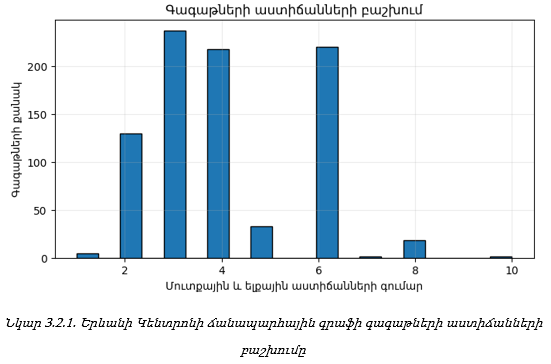
*Նկար 3.2.1. Երևանի Կենտրոնի ճանապարհային գրաֆի գագաթների աստիճանների բաշխումը*

### § 3.3. Խցանումների մոդելավորման մեթոդաբանությունը և վիճակագրական պատկերը

Քաղաքային պայմաններում երթուղու օպտիմալությունը միայն երկրաչափական երկարությամբ գնահատելը բավարար չէ, քանի որ ծանրաբեռնված մայրուղիներում շարժման արագությունը կտրուկ նվազում է։ Հետազոտության շրջանակում յուրաքանչյուր $e = (u, v)$ կողի համար սահմանվել են երկու հիմնական կշռային բնութագրեր․
*   **Ֆիզիկական երկարություն՝** $l(e) \geq 1$ մետր (ճանապարհային հատվածի իրական երկարությունը ըստ OpenStreetMap-ի)։
*   **Անցման ժամանակ՝** սահմանվում է բազային $t_0(e) = l(e) / v_0$ ժամանակի և խցանման $k(e)$ դանդաղեցման գործակցի արտադրյալով, որտեղ բազային արագությունը ընդունված է $v_0 = 40$ կմ/ժ ($\approx 11.11$ մ/վ)՝ համապատասխան քաղաքային երթևեկության ստանդարտ պայմաններին․

$$
t(e) = t_0(e) \cdot k(e) = \left(\frac{l(e)}{v_0}\right) \cdot k(e)
$$

Խցանումների սցենարը կառուցվել է Երևանի Կենտրոնի փողոցների դասակարգման և պիկ ժամերին բնորոշ ծանրաբեռնվածության հիման վրա։ Մասնավորապես, առանձնացվել են երեք խումբ ճանապարհներ․
*   **Առաջին խումբ (գերծանրաբեռնված մայրուղիներ)՝** Մյասնիկյան, Հերացու, Խանջյան, Սարալանջի, Արշակունյաց, Ագաթանգեղոսի, Մաշտոցի, Տիգրան Մեծի, Իսակովի պողոտաներն ու փողոցները, ինչպես նաև trunk և primary կարգի ճանապարհները, որտեղ ուժեղ և շատ ուժեղ խցանումների հավանականությունը ամենաբարձրն է (մինչև 78%)։
*   **Երկրորդ խումբ (միջին ծանրաբեռնվածության փողոցներ)՝** Բաղրամյան, Աբովյան, Տերյան, Կորյուն, Սայաթ-Նովա, Ամիրյան, Թումանյան, Գրիգոր Լուսավորիչ, Նալբանդյան, Չարենց, Կոմիտաս, Օրբելի, Կիևյան փողոցները և secondary դասի ճանապարհները։
*   **Երրորդ խումբ (տեղական և բակային փողոցներ)՝** tertiary և ավելի փոքր նշանակության փողոցներ, որոնք հիմնականում ազատ են կամ ունեն թույլ ծանրաբեռնվածություն։

Մոդելի վերարտադրելիությունը և տրամաբանական ամբողջականությունը ապահովելու համար կիրառվել է դետերմինիստական հեշավորման մեխանիզմ (SHA-256 և RANDOM_SEED = 42), որի շնորհիվ յուրաքանչյուր ֆիզիկական ճանապարհային հատվածի վիճակը որոշվում է միանշանակ և համաչափ կիրառվում երկկողմանի հատվածների երկու ուղղությունների վրա։ Բացի այդ, նախատեսվել է փոքր հավանականություն (0.4%) սցենարային փակ հատվածների համար ($k(e) = \infty$), որոնք մոդելավորում են վթարների կամ ճանապարհաշինական աշխատանքների հետևանքով առաջացող արգելափակումները։

| Երթևեկության վիճակ | Քարտեզի գույն | Գործակից $k(e)$ | Հատվածների քանակ | Մասնաբաժին |
| :--- | :--- | :--- | :--- | :--- |
| Ազատ ճանապարհ | Կանաչ (#2E8B57) | $\times 1.0$ | 879 | 50.3% |
| Թույլ խցանում | Դեղին (#FFD700) | $\times 1.5$ | 341 | 19.5% |
| Ուժեղ խցանում | Կարմիր (#E31A1C) | $\times 2.5$ | 293 | 16.8% |
| Շատ ուժեղ խցանում | Մուգ կարմիր (#8B0000) | $\times 3.0$ | 229 | 13.1% |
| Սցենարային փակ հատված | Մոխրագույն (#808080) | $\infty$ | 5 | 0.3% |

Վիճակագրական վերլուծությունը ցույց է տալիս, որ 1747 ճանապարհային հատվածներից 863-ը (ընդհանուր 119.63 կմ երկարությամբ) գտնվում են տարբեր աստիճանի ծանրաբեռնվածության ներքո՝ 2.24 միջին դանդաղեցման գործակցով, իսկ 5 հատված ժամանակավորապես փակ է։ Խցանված հատվածների միջին երկարությունը կազմում է 138.62 մ, միջին բազային անցման ժամանակը՝ 12.48 վրկ, իսկ ծանրաբեռնված պայմաններում միջին անցման ժամանակը աճում է մինչև 28.55 վրկ։ Դանդաղեցման գործակիցների քանակական բաշխումը պատկերված է Նկար 3.3.1-ում։

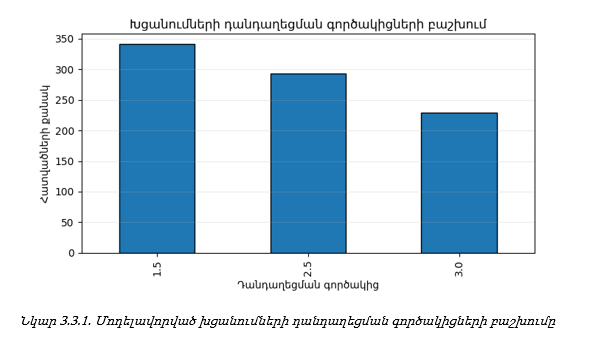
*Նկար 3.3.1. Մոդելավորված խցանումների դանդաղեցման գործակիցների բաշխումը*

### § 3.4. Առանցքային հանգույցների բացահայտումը միջնորդական կենտրոնականության միջոցով

Քաղաքային ճանապարհային ցանցի խոցելիությունը գնահատելու համար կարևոր է պարզել, թե որ խաչմերուկներն են ամենաշատը մասնակցում տարբեր ուղղություններով կատարվող երթևեկությանը։ Այդ նպատակով կիրառվել է միջնորդական կենտրոնականության (Betweenness Centrality) չափանիշը, որը գնահատում է, թե գրաֆի բոլոր գագաթների զույգերի միջև անցնող կարճագույն ճանապարհների որ մասն է անցնում տվյալ $v$ գագաթով․

$$
C_B(v) = \sum_{s \neq v \neq t} \frac{\sigma_{st}(v)}{\sigma_{st}}
$$

որտեղ $\sigma_{st}$-ն $s$-ից $t$ տանող կարճագույն ճանապարհների ընդհանուր քանակն է, իսկ $\sigma_{st}(v)$-ն՝ դրանցից $v$ գագաթով անցնող ճանապարհների քանակը։ Հաշվարկը կատարվել է ճանապարհի երկարության կշռով՝ $k = 200$ հանգույցների նորմավորված ընտրանքով։ Առավել բարձր կենտրոնականություն ունեցող առաջին 5 հանգույցները ներկայացված են Աղյուսակ 3.4.1-ում․

| Հանգույցի ID (OSM) | Կենտրոնականություն | Լայնություն (Lat) | Երկայնություն (Lon) |
| :--- | :--- | :--- | :--- |
| 10830785385 | 0.130993 | 40.174123 | 44.500752 |
| 632031882 | 0.130087 | 40.178584 | 44.515120 |
| 4688983926 | 0.127602 | 40.178147 | 44.512302 |
| 4209742296 | 0.126912 | 40.174861 | 44.505487 |
| 354684596 | 0.126463 | 40.178136 | 44.512202 |

Աշխարհագրական կոորդինատների համադրումը ցույց է տալիս, որ ամենաբարձր միջնորդական կենտրոնականությամբ հանգույցները տեղակայված են Կենտրոնի գլխավոր տրանսպորտային զարկերակների՝ Մաշտոցի, Ամիրյանի, Գրիգոր Լուսավորչի, Արգիշտիի և Խանջյան փողոցների հատման հանգույցներում։ Հետևաբար, հենց այս հանգույցներում առաջացող խցանումներն են ամենաուժեղ ազդեցությունն ունենում ամբողջ շրջանի երթևեկության ժամանակի վրա։

### § 3.5. Դեյկստրայի և A* ալգորիթմների կիրառումը և փորձարարական արդյունքների համեմատությունը

Երթուղիների որոնման փուլում նախ սկզբնական $G$ գրաֆից առանձնացվում է բաց հատվածների $G_{open}$ ենթագրաֆը (հեռացնելով $t(e) = \infty$ կշռով սցենարային փակ կողերը), և ընտրվում է դրա ամենամեծ ուժեղ կապակցված բաղադրիչը (833 գագաթ), ինչը երաշխավորում է ցանկացած երկու ընտրված կետերի միջև ուղղորդված ճանապարհի գոյությունը։ Փորձարկման համար ընտրվել են միմյանցից տարածականորեն հեռու գտնվող A սկզբնակետը (ID՝ 11644940327, կոորդինատներ՝ 40.183693, 44.523483) և B նպատակակետը (ID՝ 6277544437, կոորդինատներ՝ 40.169114, 44.515403)։

Զուգահեռ կողերի առկայության դեպքում յուրաքանչյուր $(u, v)$ անցման համար ընտրվում է տվյալ չափանիշով նվազագույն կշիռ ունեցող կողը։ A* ալգորիթմի համար որպես հևրիստիկ ֆունկցիա կիրառվել է երկրագնդի կորությունը հաշվի առնող Haversine ուղիղ հեռավորությունը՝ բաժանված առավելագույն բազային արագության վրա․

$$
h(n, t) = \frac{d_{Haversine}(n, t)}{v_0}
$$

Քանի որ ցանկացած ճանապարհային հատվածի իրական երկարությունը փոքր չէ ուղիղ հեռավորությունից, իսկ դանդաղեցման գործակիցը բավարարում է $k(e) \geq 1$ պայմանին, ապա $h(n, t) \leq h^*(n, t)$ անհավասարությունը միշտ տեղի ունի։ Այսինքն՝ հևրիստիկ ֆունկցիան թույլատրելի է (admissible), ինչը երաշխավորում է A* ալգորիթմի կողմից գտնված լուծման օպտիմալությունը։

| Երթուղու տարբերակ | Երկարություն (կմ) | Ժամանակ (րոպե) | Խցանված հատվածներ | Գագաթների քանակ |
| :--- | :--- | :--- | :--- | :--- |
| Ամենակարճ՝ ըստ հեռավորության | 2.29 | 8.58 | 13 | 21 |
| Ամենաարագ՝ Դեյկստրա | 2.86 | 6.12 | 7 | 20 |
| Ամենաարագ՝ A* | 2.86 | 6.12 | 7 | 20 |

Աղյուսակ 3.5.1-ի տվյալներից կարելի է անել հետևյալ կարևոր եզրահանգումները․
*   **Ալգորիթմների համընկնումը՝** Դեյկստրայի և A* ալգորիթմները ժամանակային կշռման դեպքում վերադարձրել են միևնույն օպտիմալ երթուղին (20 գագաթ, 2.86 կմ, 6.12 րոպե), ինչը փորձնականորեն հաստատում է ընտրված Haversine հևրիստիկի թույլատրելիությունը։
*   **Երկարության և ժամանակի փոխզիջումը (Trade-off)՝** Ֆիզիկական հեռավորությամբ ամենակարճ երթուղին ունի ընդամենը 2.29 կմ երկարություն, սակայն անցնում է 13 խցանված հատվածով, ինչի հետևանքով պահանջում է 8.58 րոպե։ Դրա փոխարեն, խցանումները հաշվի առնող ամենաարագ երթուղին շրջանցում է ծանրաբեռնված հատվածները (անցնելով ընդամենը 7 խցանված հատվածով)․ թեև դրա երկարությունը 0.57 կմ-ով (+24.9%) ավելի մեծ է, այն խնայում է 2.46 րոպե՝ կրճատելով ուղևորության տևողությունը 28.7%-ով։
*   **Խցանումների ընդհանուր ազդեցությունը՝** Առանց խցանումների սցենարի դեպքում նույն A $\to$ B երթուղին կանցնվեր 3.44 րոպեում, մինչդեռ պիկ ժամերի մոդելավորված ծանրաբեռնվածության պայմաններում նույնիսկ օպտիմալացված երթուղին պահանջում է 6.12 րոպե (+2.67 րոպե կամ +77.7% ժամանակի աճ)։

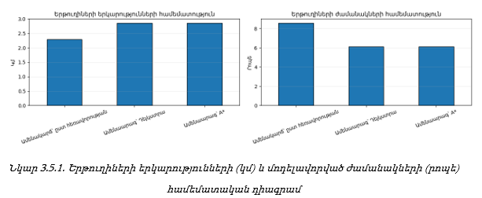
*Նկար 3.5.1. Երթուղիների երկարությունների (կմ) և մոդելավորված ժամանակների (րոպե) համեմատական դիագրամ*

Արդյունքների քարտեզագրական վիզուալիզացիան իրականացվել է Folium գրադարանի միջոցով՝ Google Maps քարտեզային շերտի վրա, որտեղ գունային կոդավորմամբ (կանաչ, դեղին, կարմիր, մուգ կարմիր և մոխրագույն) արտացոլված են ցանցի բոլոր 1747 հատվածների ծանրաբեռնվածության մակարդակները, իսկ կապույտ և մանուշակագույն գծերով՝ համապատասխանաբար ամենակարճ և ամենաարագ երթուղիները։

### § 3.6. Քարտեզագրական վիզուալիզացիա և երթուղիների համեմատություն

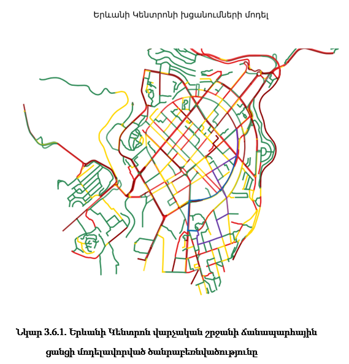
*Նկար 3.6.1. Երևանի Կենտրոն վարչական շրջանի ճանապարհային ցանցի մոդելավորված ծանրաբեռնվածությունը*

Քարտեզում ներկայացված է Երևանի Կենտրոն վարչական շրջանի ճանապարհային ցանցի մոդելավորված ծանրաբեռնվածությունը: Գույներով առանձնացված են ճանապարհների տարբեր վիճակները՝ ազատ ճանապարհները ($\times 1.0$ գործակից) նշված են կանաչով, թույլ խցանումները ($\times 1.5$)՝ դեղինով, ուժեղ խցանումները ($\times 2.5$)՝ կարմիրով, իսկ շատ ուժեղ խցանումները ($\times 3.0$)՝ մուգ կարմիրով: Մոխրագույնով նշված են սցենարային փակ հատվածները, որոնք մոդելավորում են ժամանակավոր արգելափակումները:

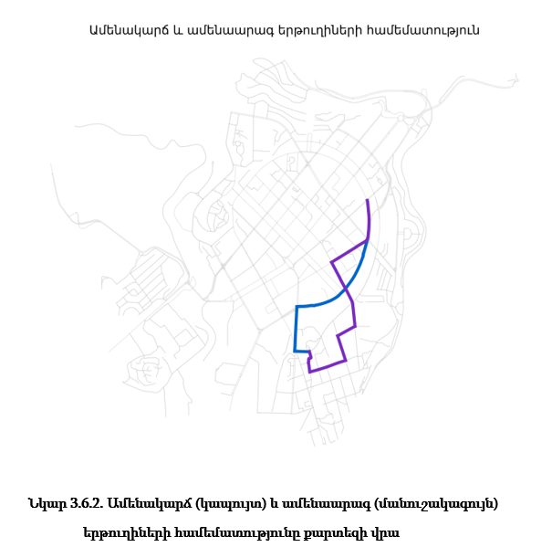
*Նկար 3.6.2. Ամենակարճ (կապույտ) և ամենաարագ (մանուշակագույն) երթուղիների համեմատությունը քարտեզի վրա*

Քարտեզում համեմատվում են A (սկզբնակետ) և B (նպատակակետ) կետերի միջև կառուցված երկու տարբեր երթուղիներ: Կապույտ գույնով ցուցադրված է ըստ հեռավորության ամենակարճ երթուղին (2.29 կմ), որն անցնում է 13 խցանված հատվածով և պահանջում 8.58 րոպե ժամանակ: Մանուշակագույնով պատկերված է խցանումները հաշվի առնող ամենաարագ երթուղին (2.86 կմ), որը գտնվել է Դեյկստրայի և A* ալգորիթմների միջոցով: Թեև այս երթուղին ֆիզիկապես ավելի երկար է, այն խուսափում է հիմնական ծանրաբեռնված հատվածներից (անցնում է ընդամենը 7 խցանված հատվածով) և կրճատում ուղևորության տևողությունը մինչև 6.12 րոպե:

---

<h2 id="գրականություն">Օգտագործված գրականության ցանկ</h2>

1. Գրաֆների Տեսություն։ Պ․Ա․Պետրոսյան, Վ․Վ․ Մկրտչյան, Ռ․Ռ․Քամալյան
2. Russell, S. J., Norvig, P. Artificial Intelligence: A Modern Approach. 4th ed., Pearson, 2021/2022
3. «Алгоритмы. Построение и анализ»։ Томас Х. Кормен, Чарльз Э. Лейзерсон, Рональд Л. Ривест, Клиффорд Штайн
4. Introduction to Graph Theory: Douglas B. West
5. Graph Theory: Reinhard Diestel
6. Graph Theory and Its Applications: Jay Yellen